# Portfolio personal · Matías Adrián González

Trabajo final de **Diseño UX-UI 2026** · Licenciatura en Sistemas de Información · UADER FCyT.

> Estado: en construcción. Este README se completa a medida que avanza el proyecto.

## Enlaces

| Qué | Dónde |
|---|---|
| Sitio publicado | _Pendiente de deploy_ |
| Figma (research, wireframes, design system y prototipo) | https://www.figma.com/design/Tmljy6R7M0EqlpMWRcDYP3 |
| Reporte Lighthouse (mobile) | _Pendiente_ |

## Stack

- HTML5 semántico + CSS3 (variables CSS para el design system) + JavaScript vanilla.
- Sin frameworks JS ni constructores visuales, como pide la consigna.
- _A confirmar:_ CSS puro o Tailwind compilado con CLI.

## Proceso UX

1. **Usuario objetivo:** proto-persona (Carolina, reclutadora IT) y escenario de uso.
2. **Benchmark:** 3 portfolios de referencia más inspiración visual adicional.
3. **Moodboard y concepto:** palabras clave _autodidacta_, _práctico_ y _en evolución_, traducidas a color, tipografía e imágenes.
4. **Arquitectura de información:** sitemap y card sorting.
5. **Wireframes, design system y prototipo:** en Figma (wireframes mobile y desktop, tokens y 5 componentes con variantes, prototipo clickeable de alta fidelidad).
6. **Validación:** test de usabilidad con al menos 3 personas _(pendiente)_.

_Las imágenes son grandes: hacé clic en cada una para verla a tamaño completo._

### Investigación

[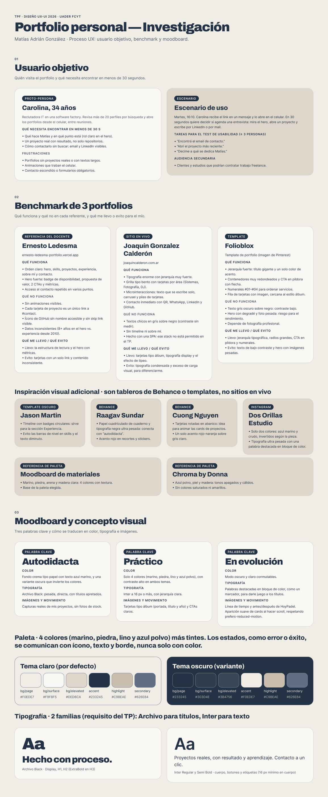](docs/investigacion.png)

### Arquitectura de información

Una sola página con anclas, más un caso de estudio interno y una página 404. Se cambia el orden de la consigna (la consigna lo permite si se justifica): **Skills va justo después del Hero** porque el usuario objetivo primero escanea el stack para saber si encaja, después ve un proyecto real y **Métricas va después de Proyectos**, donde las cifras funcionan como prueba de lo que se acaba de ver.

| # | Sección | Ancla |
|---|---|---|
| 01 | Header / Navegación | global |
| 02 | Hero | `#inicio` |
| 03 | Skills | `#skills` |
| 04 | Proyectos | `#proyectos` |
| 05 | Métricas | `#metricas` |
| 06 | Experiencia / Formación | `#experiencia` |
| 07 | Sobre mí (con "Cómo trabajo") | `#sobre-mi` |
| 08 | Contacto | `#contacto` |
| 09 | Footer | global |

Páginas adicionales: `caso-hoypadel.html` (caso de estudio) y `404.html`.

[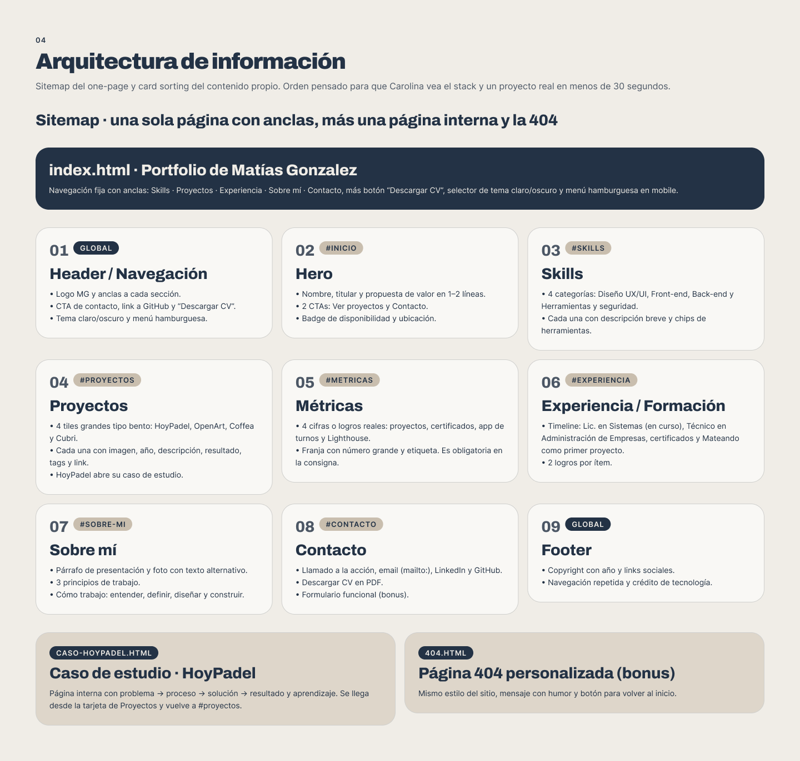](docs/arquitectura-sitemap.png)

[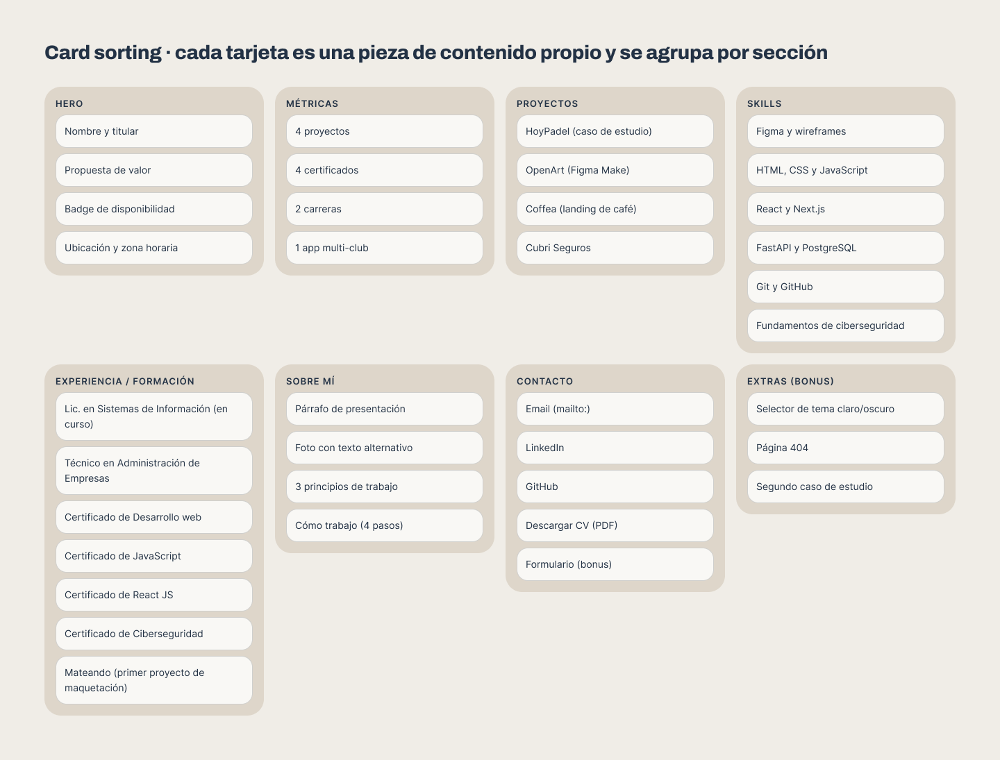](docs/arquitectura-card-sorting.png)

### Wireframes de baja fidelidad

Página completa en desktop (1440 px) y mobile (375 px), más el menú mobile abierto. Incluyen las 9 secciones, el botón de descarga de CV, el selector de tema y el formulario opcional de contacto.

Decisiones de diseño tomadas a partir de las referencias:

- **Hero completo** con un retrato del autor como imagen principal, degradé para asegurar el contraste del texto y navegación mínima flotante (logo, 4 enlaces, botón de contacto y selector de tema). La sección Sobre mí repite la foto con texto alternativo.
- **Texto del hero con la estructura de las referencias** (Dominic, Daniel James y Arjun): el nombre en tamaño grande (en las primeras versiones era una etiqueta chica y pasaba desapercibido), titular grande orientado al beneficio ("Tu negocio, más simple"; se descartó "venden por vos" porque promete resultados que todavía no se pueden respaldar y suena a agencia), una línea descriptiva sobre quién soy (estudiante de Lic. en Sistemas, autodidacta y emprendedor), botón primario "Hablemos de tu negocio" y secundario "Ver proyectos", íconos de redes, tarjetas flotantes sobre la foto (disponibilidad, ubicación y estudio) e indicador "Scroll para explorar" centrado abajo. Todo en una columna a la izquierda, centrada verticalmente, con el retrato a la derecha: un único recorrido de lectura y el texto siempre sobre fondo oscuro (contraste). En mobile la foto va arriba con el chip de disponibilidad y el texto abajo sobre marino sólido, solo con lo esencial, en tres grupos con aire entre sí: identidad (nombre más línea descriptiva), titular y botones, más la flecha de scroll; sin tarjetas ni redes. En una versión anterior el nombre y el titular tenían casi el mismo tamaño y el hero se veía apretado, porque en la primera versión el texto se superponía con la foto y no se leía.
- **Sobre mí propio, sin tarjetas:** retrato en arco con tres stickers inclinados (_Autodidacta_, _Práctico_, _En evolución_, las palabras clave del moodboard), una frase grande con palabras resaltadas, el párrafo de presentación, **3 principios como filas desplegables** (acordeón con `aria-expanded`, la consigna pide 3 principios) y una línea "Ahora" con lo que estoy haciendo hoy.
- **Footer con llamado a la acción:** bloque marino con "Hablemos de tu negocio", navegación repetida, redes (GitHub, LinkedIn, Instagram, WhatsApp, email y CV), marca decorativa y franja legal con año y crédito de tecnología, más un botón "Volver arriba". Cubre lo que pide la consigna para el footer sin recargar la página.
- **Contacto rápido sin recargar:** Instagram y WhatsApp se suman a las listas que ya existían (footer y Contacto) y hay **un solo elemento flotante**, un botón de WhatsApp chico abajo a la derecha, con un pulso suave. En el sitio aparece al pasar el hero, repite el pulso pocas veces, se desactiva con `prefers-reduced-motion` y tiene nombre accesible ("Escribime por WhatsApp"). No se usa el verde de la marca de WhatsApp para respetar la paleta.
- **Skills como tiles bento** (marino y piedra alternados, con chips y brillo al pasar el mouse) en lugar de una lista de texto: misma familia visual que los tiles de proyecto.
- **Métricas como banda compacta:** la consigna exige la sección (3 a 4 cifras o logros), así que se resuelve con una banda marino con cifras grandes y una etiqueta de una línea (5 proyectos UX/UI, 4 certificados, 1 app de turnos, Lighthouse 90+), en lugar de una sección grande.
- **Tiles de proyecto** tipo bento inspirados en el portfolio de Joaquín Calderón: título grande, subtítulo con líneas, abanico de pantallas inclinadas y pie con tags y link. Al pasar el mouse o enfocar con teclado el abanico se abre y aparece un brillo radial. El contenido obligatorio y el link siempre son visibles sin hover.
- **Secciones con pocas cajas y bordes**: más espacio en blanco, líneas finas y tipografía grande, para un resultado minimalista.

[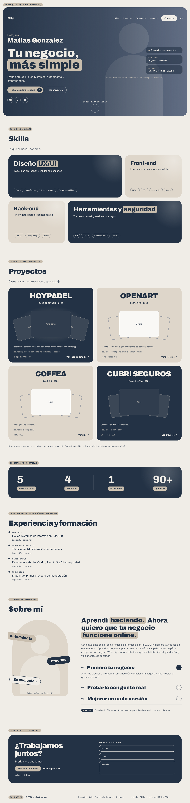](docs/wireframe-desktop.png)

[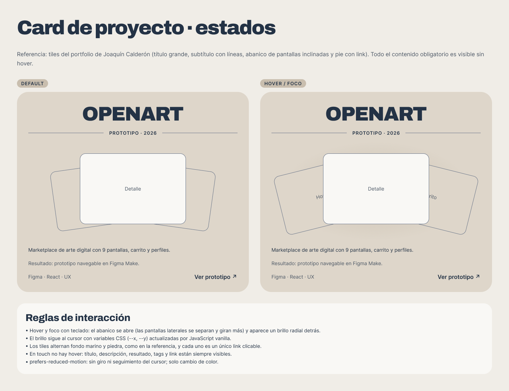](docs/wireframe-card-estados.png)

  <a href="docs/wireframe-mobile.png">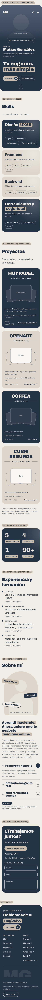</a>
  <a href="docs/wireframe-mobile-menu.png">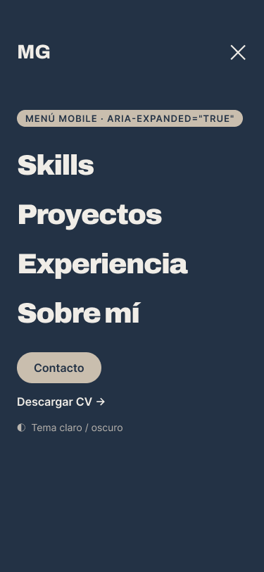</a>

## Design system (resumen)

- **Colores (4):** marino `#233245`, piedra `#DED6CA`, lino `#C9BEAE` y azul polvo `#626E84`, más tintes derivados.
- **Temas:** claro por defecto y oscuro, con contraste de texto mínimo de 4.5:1 en ambos.
- **Tipografía (2 familias):** Archivo para títulos e Inter para texto.
- **Estados:** error y éxito se comunican con ícono, texto y borde, nunca solo con color.
- **Tokens en Figma:** variables de color (modo claro y oscuro), espaciado (4 a 96) y radios, más estilos de texto. Todos los componentes están vinculados a esas variables, así que el cambio de tema es automático.

[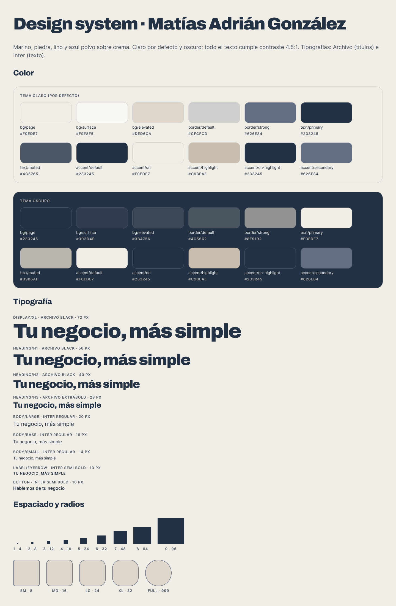](docs/design-system-fundamentos.png)

### Componentes

Seis componentes con variantes, hechos con tokens y estilos de texto:

| Componente | Variantes |
|---|---|
| **Button** | primario y secundario × default, hover, focus (anillo doble) y disabled |
| **Tag** | contorno, relleno y resaltado |
| **Input** | default, focus, error (borde grueso + ícono + mensaje, sin depender del color) y disabled |
| **Timeline item** | default y en curso (punto relleno + etiqueta) |
| **Project tile** | oscuro y claro × default y hover (abanico abierto + brillo) |
| **WhatsApp FAB** | reposo y pulso (anillo que se expande y se desvanece); abre WhatsApp |

[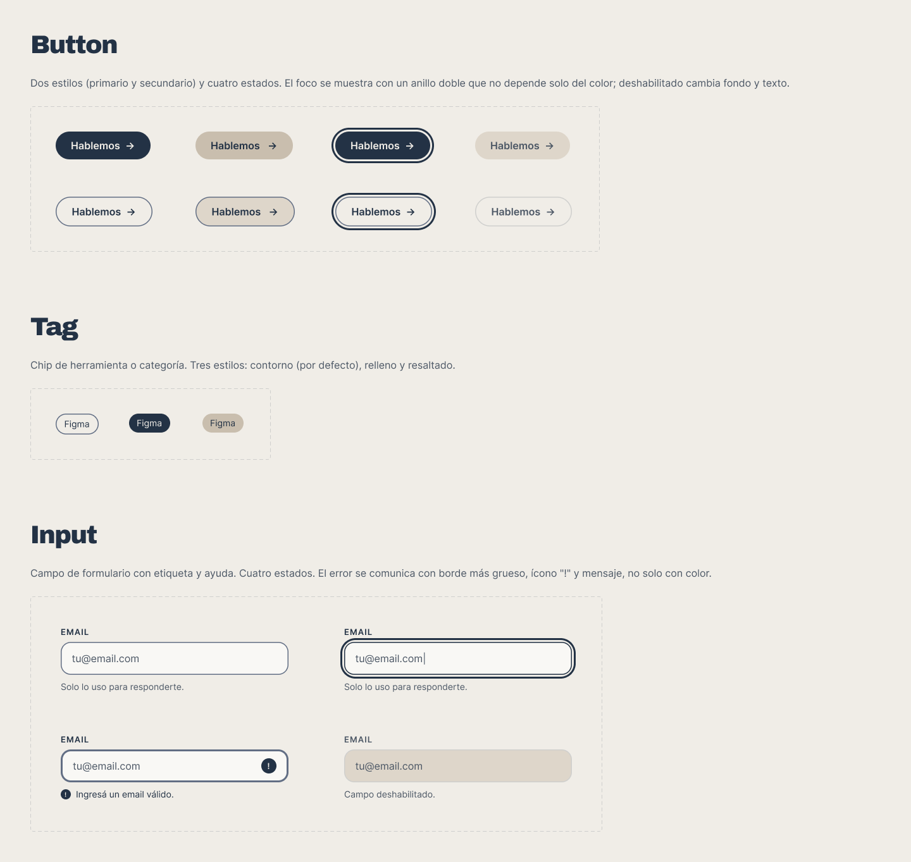](docs/design-system-componentes-1.png)

[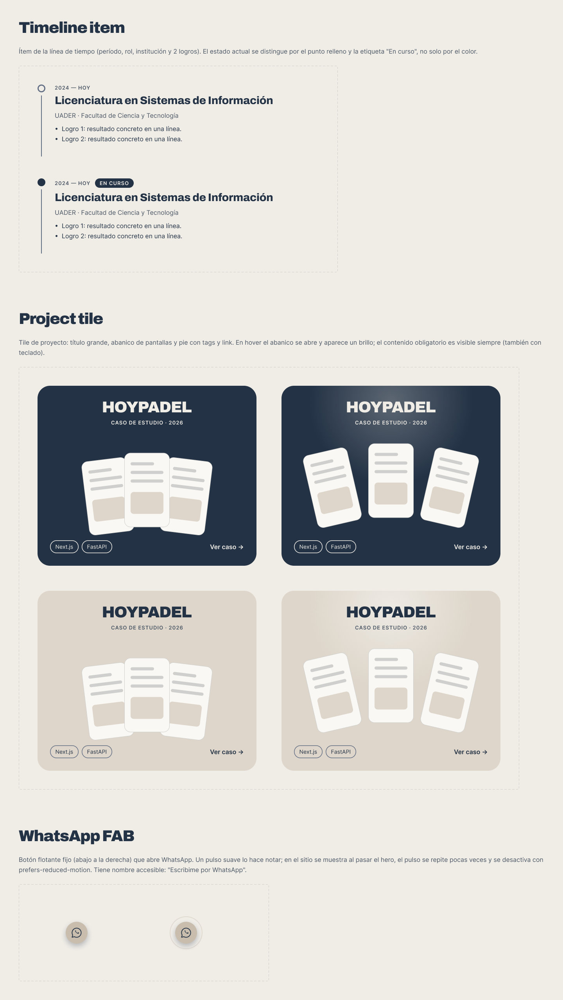](docs/design-system-componentes-2.png)

## Prototipo de alta fidelidad

Prototipo clickeable en Figma (desktop y mobile), construido con los componentes y tokens del design system. Se puede probar en modo presentación desde el link de Figma.

- **Navegación:** barra fija arriba que, sobre el hero, se ve integrada y transparente como en el wireframe, y al hacer scroll queda fija y sólida. Figma no permite cambiar un elemento según el scroll, así que en el prototipo la barra usa el mismo degradé que el hero: arriba de todo no se distingue y al scrollear se mantiene sólida. En el sitio final se hace con JavaScript (transparente sobre el hero, sólida o con desenfoque al hacer scroll, y vuelve a transparente al regresar al hero). La barra tiene las esquinas de abajo redondeadas con el mismo radio del hero (32 px). Los links llevan con scroll suave a cada sección, con botón de contacto y menú hamburguesa en mobile (overlay con los mismos links).
- **Hero mobile a pantalla completa:** en celular el hero ocupa todo el ancho, sin los márgenes laterales de desktop, porque el margen resta mucho en una pantalla tan angosta; mantiene las esquinas inferiores redondeadas.
- **Flujo principal:** Home → tile de HoyPadel → caso de estudio → volver.
- **Caso de estudio de HoyPadel:** problema → proceso → solución → resultado y aprendizaje, con capturas y llamado a la acción final.

[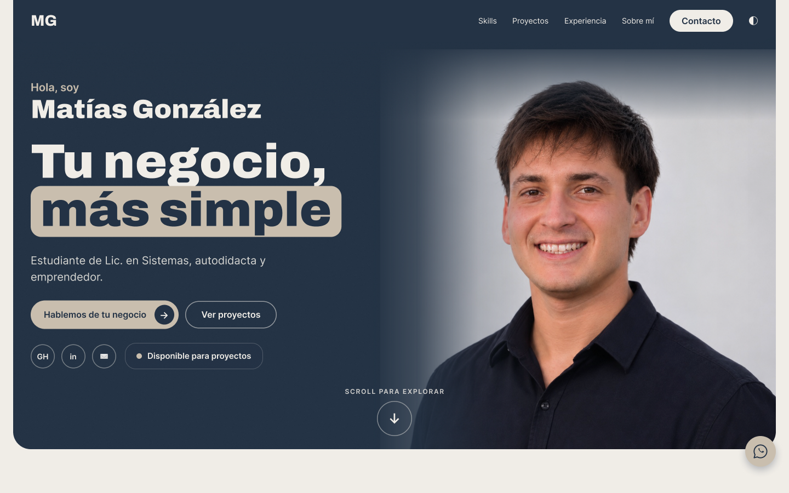](docs/prototipo-desktop-home.png)

[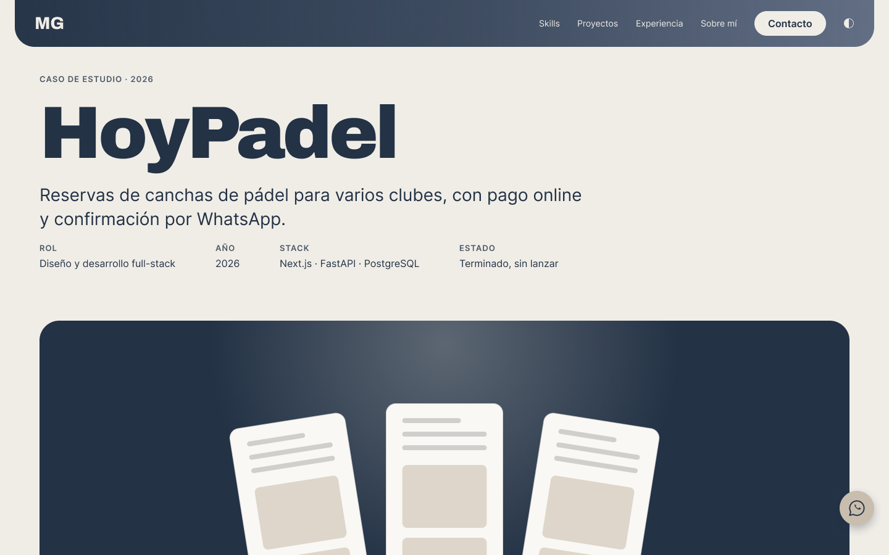](docs/prototipo-desktop-caso.png)

  <a href="docs/prototipo-mobile-home.png">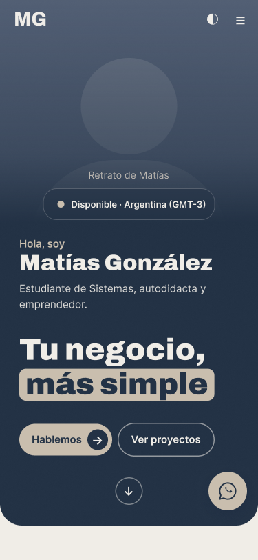</a>
  <a href="docs/prototipo-mobile-menu.png">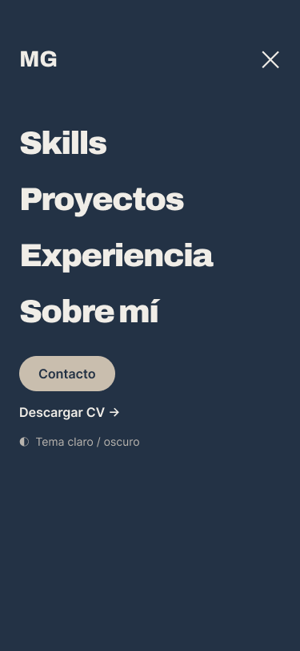</a>
  <a href="docs/prototipo-mobile-caso.png">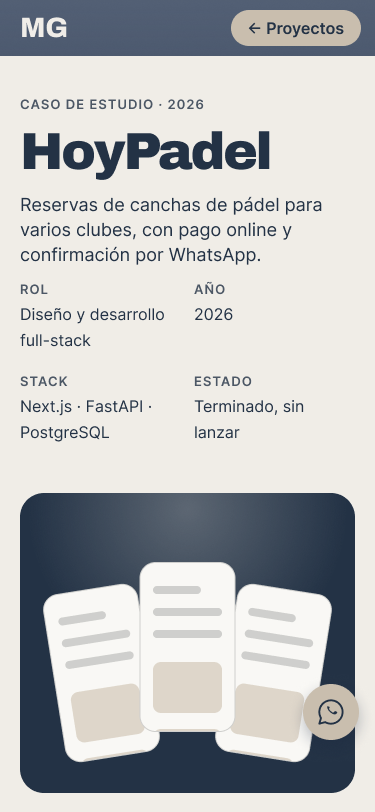</a>

_Pendiente: las imágenes de proyectos y mi foto son marcadores de posición hasta tener los archivos finales._

## Fuentes, recursos y créditos

- Tipografías: [Archivo](https://fonts.google.com/specimen/Archivo) e [Inter](https://fonts.google.com/specimen/Inter) (Google Fonts).
- Referencias de inspiración, sin copiar su estilo: portfolio del docente (Ernesto Ledesma), Joaquín Gonzalez Calderón, Folioblox, Dos Orillas Estudio, y tableros de Behance de Raagav Sundar y Cuong Nguyen.
- Referencias de paleta: moodboard de materiales de Stylingentrends y Chroma by Donna.
- No se usa ningún template de código como base.

## Uso de inteligencia artificial

Se usó **Claude (Anthropic)** como asistente durante el proceso. Qué se generó y cómo se revisó:

- Borradores en Figma: tablero de investigación, sitemap, card sorting, wireframes, design system con componentes y prototipo. Los textos de ejemplo (por ejemplo el caso de estudio de HoyPadel) se escribieron como borrador y el autor los revisa y corrige.
- Cálculo de contrastes de color (WCAG) y análisis de los portfolios de referencia.
- Las **decisiones de concepto** (palabras clave, paleta, tipografía, orden de secciones y contenido) las tomó el autor, que revisó y corrigió cada propuesta.
- _Se completa a medida que se genere código o texto con asistencia._

## Despliegue

_Pendiente: se documentará la plataforma elegida, la conexión con este repositorio y el deploy automático en cada push a `main`._
